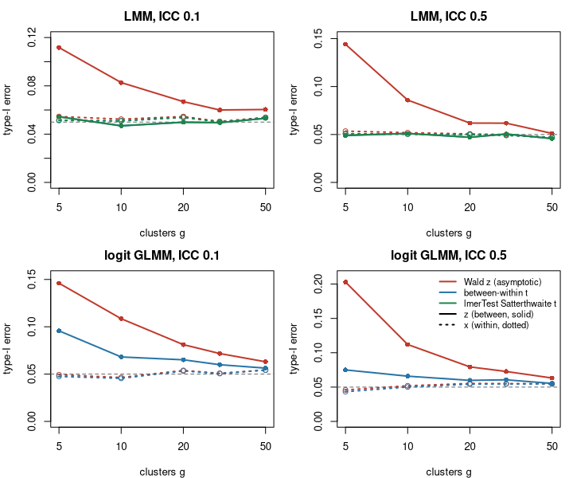
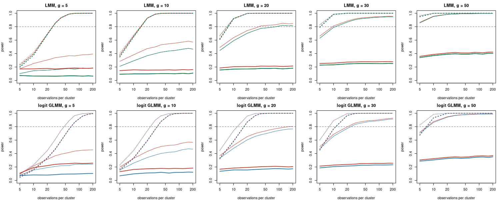
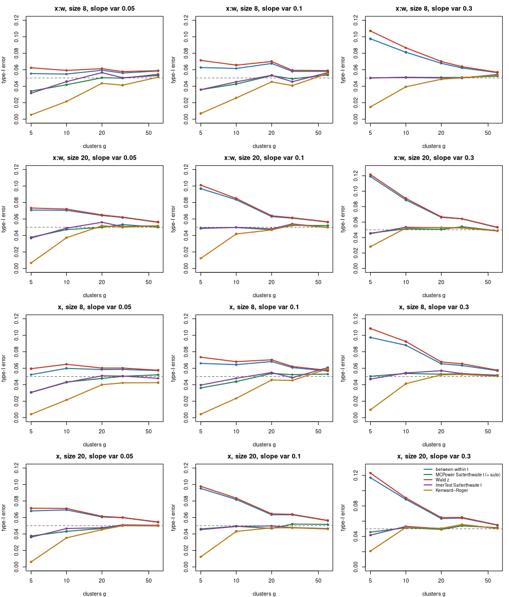

# MCPower validation — denominator df calibration (mixed models)

# What this report shows

A mixed-model fixed-effect test needs a reference distribution. On the
single-grouping, random-intercept designs this grid covers, MCPower’s
default (`df_method = "auto"`) is a **t with between-within degrees of
freedom** (SAS `DDFM=BETWITHIN`): a cluster-level predictor is referred
to the between-cluster df, an observation-level predictor to the
within-cluster df, and a fit whose random-effect variances all collapse
to zero to the residual df. The `Denominator df` setting swaps it for
the asymptotic **Wald z**. This page measures how far each choice sits
from the nominal 5% when the number of clusters is small, and what that
does to the recommended sample size. The external reference is
**lmerTest’s Satterthwaite t** on the same generated data (linear mixed
model only — lmerTest does not fit GLMMs, so the logit cells carry the
two MCPower arms only).

Nothing here is a pass/fail gate. The numbers are the evidence for the
default on these designs. They are what moved it from the Wald z to
between-within. A linear mixed model with a random slope, or with
crossed or nested groupings, is tested at per-fit Satterthwaite df under
the default instead. The intercept-only grid does not cover those
designs; the random-slope grid at the end of this page covers
single-grouping models with a random slope, against lmerTest,
Kenward–Roger and Wald z.

# What between-within df is

A Wald z treats the standard error of a coefficient as known. In a mixed
model it is not: the standard error of a cluster-level coefficient comes
from the spread of g cluster means, so it carries the uncertainty of g
numbers, not of N observations. With few clusters the z reference is too
narrow and the test rejects too often. The between-within rule (SAS
`PROC MIXED`, `DDFM=BETWITHIN`) refers each fixed effect to a *t* whose
denominator df counts the units that inform it:

- **between df** = g − (number of fixed effects constant within a
  cluster, intercept included). Here the intercept and `z` are
  cluster-level, so g − 2.
- **within df** = N − g − (number of fixed effects that vary inside
  clusters). Here only `x`, so N − g − 1. The two add up to N − p, the
  ordinary residual df.
- **joint test** of k effects: k·F(k, df) with the smallest df across
  the target set (here g − 2).
- **collapsed fit** (every random-effect variance estimated at zero,
  lme4’s “singular fit”): the cluster split no longer describes the
  fitted model, so a linear mixed model fit is referred to Student *t*
  on N − p and a GLMM fit to Wald z.

A predictor counts as cluster-level only when the user declares it (the
cluster-level-variables argument of `set_cluster`); the engine does not
detect it from the data. The rule applies to LMM and clustered GLMM
fixed effects alike: the statistic is the same Wald ratio, only its
reference changes.

Satterthwaite df, the lmerTest default, instead estimates the df from
how variable the variance estimate itself is. On a balanced
random-intercept design like this one it gives g − 2 for a cluster-level
effect, the same as between-within. For the within-cluster effect `x` it
comes out somewhat above N − g − 1 (`x` is a random covariate, so part
of its variation sits between clusters); both df are far enough into the
tail that the critical values are practically the same. The tables below
show both df columns. Kenward–Roger also adjusts the standard error and
is not part of the intercept-only grid; the random-slope grid includes
it.

# The grid

Every cell fits `y ~ x + z + (1|g)`: `x` varies within clusters, `z` is
constant within a cluster (declared cluster-level). Clusters are
balanced with 20 observations each, so N = 20 × g.

| Setting | Value |
|----|----|
| Clusters g | 5, 10, 20, 30, 50 |
| ICC | 0.1, 0.5 |
| Families | lme, logit |
| Draws per cell (type-I) | 10,000 |
| Draws per N-grid point (power) | 10,000 |
| α | 0.05 |
| Alternative effect | LMM 0.25; logit 0.405 (log-odds), baseline p = 0.5 |
| Versions | mcpower 1.4.1, lmerTest 3.2.1, lme4 2.0.6 |

All arms score the **same generated bytes** per draw: MCPower’s own fit
gives the statistic and each arm’s critical value; lmerTest refits the
identical design, outcome, and cluster ids. A draw counts only when
every arm scored it (engine converged, lmerTest fit succeeded). The
Monte-Carlo standard error on a 5% rate at 10,000 draws is about 0.22
percentage points.

# Type-I error at effect = 0

Rejection rate at the null, per arm and target. Between-within df for
`z` is g − 2 (intercept and `z` are both cluster-level) and for `x` N −
g − 1 on a live fit. In the linear mixed model a collapsed fit (every
random-effect variance at zero) is referred to the residual df N − 3 on
both targets; a collapsed logit fit falls to Wald z and carries no df.
The df columns for the between-within and Satterthwaite arms are means
over draws, so on logit cells the between-within mean runs over the live
draws only. “Collapsed” is the share of draws whose fit collapsed.

## Linear mixed model

| ICC | g | N | target | arm | df | collapsed % | type-I % | 95% CI |
|---:|---:|---:|:---|:---|---:|---:|---:|:---|
| 0.1 | 5 | 100 | x (within) | Wald z (asymptotic) | ∞ | 18.5 | 5.5 | 5.0 – 5.9 |
| 0.1 | 5 | 100 | x (within) | between-within t | 94.6 | 18.5 | 5.1 | 4.7 – 5.6 |
| 0.1 | 5 | 100 | x (within) | lmerTest Satterthwaite t | 95.6 | 18.5 | 5.1 | 4.7 – 5.6 |
| 0.1 | 5 | 100 | z (between) | Wald z (asymptotic) | ∞ | 18.5 | 11.2 | 10.6 – 11.8 |
| 0.1 | 5 | 100 | z (between) | between-within t | 20.4 | 18.5 | 5.4 | 5.0 – 5.9 |
| 0.1 | 5 | 100 | z (between) | lmerTest Satterthwaite t | 20.4 | 18.5 | 5.4 | 5.0 – 5.9 |
| 0.1 | 10 | 200 | x (within) | Wald z (asymptotic) | ∞ | 4.0 | 5.2 | 4.8 – 5.7 |
| 0.1 | 10 | 200 | x (within) | between-within t | 189.3 | 4.0 | 5.1 | 4.7 – 5.5 |
| 0.1 | 10 | 200 | x (within) | lmerTest Satterthwaite t | 193.4 | 4.0 | 5.1 | 4.7 – 5.5 |
| 0.1 | 10 | 200 | z (between) | Wald z (asymptotic) | ∞ | 4.0 | 8.3 | 7.7 – 8.8 |
| 0.1 | 10 | 200 | z (between) | between-within t | 15.5 | 4.0 | 4.7 | 4.3 – 5.1 |
| 0.1 | 10 | 200 | z (between) | lmerTest Satterthwaite t | 15.5 | 4.0 | 4.7 | 4.3 – 5.1 |
| 0.1 | 20 | 400 | x (within) | Wald z (asymptotic) | ∞ | 0.2 | 5.5 | 5.0 – 5.9 |
| 0.1 | 20 | 400 | x (within) | between-within t | 379.0 | 0.2 | 5.4 | 5.0 – 5.8 |
| 0.1 | 20 | 400 | x (within) | lmerTest Satterthwaite t | 388.8 | 0.2 | 5.4 | 5.0 – 5.8 |
| 0.1 | 20 | 400 | z (between) | Wald z (asymptotic) | ∞ | 0.2 | 6.7 | 6.2 – 7.2 |
| 0.1 | 20 | 400 | z (between) | between-within t | 18.8 | 0.2 | 5.0 | 4.6 – 5.4 |
| 0.1 | 20 | 400 | z (between) | lmerTest Satterthwaite t | 18.8 | 0.2 | 5.0 | 4.6 – 5.4 |
| 0.1 | 30 | 600 | x (within) | Wald z (asymptotic) | ∞ | 0.0 | 5.1 | 4.6 – 5.5 |
| 0.1 | 30 | 600 | x (within) | between-within t | 569.0 | 0.0 | 5.0 | 4.6 – 5.5 |
| 0.1 | 30 | 600 | x (within) | lmerTest Satterthwaite t | 584.2 | 0.0 | 5.0 | 4.6 – 5.5 |
| 0.1 | 30 | 600 | z (between) | Wald z (asymptotic) | ∞ | 0.0 | 6.0 | 5.6 – 6.5 |
| 0.1 | 30 | 600 | z (between) | between-within t | 28.2 | 0.0 | 5.0 | 4.5 – 5.4 |
| 0.1 | 30 | 600 | z (between) | lmerTest Satterthwaite t | 28.2 | 0.0 | 5.0 | 4.5 – 5.4 |
| 0.1 | 50 | 1000 | x (within) | Wald z (asymptotic) | ∞ | 0.0 | 5.4 | 5.0 – 5.8 |
| 0.1 | 50 | 1000 | x (within) | between-within t | 949.0 | 0.0 | 5.3 | 4.9 – 5.8 |
| 0.1 | 50 | 1000 | x (within) | lmerTest Satterthwaite t | 974.7 | 0.0 | 5.3 | 4.9 – 5.8 |
| 0.1 | 50 | 1000 | z (between) | Wald z (asymptotic) | ∞ | 0.0 | 6.0 | 5.6 – 6.5 |
| 0.1 | 50 | 1000 | z (between) | between-within t | 48.0 | 0.0 | 5.3 | 4.9 – 5.8 |
| 0.1 | 50 | 1000 | z (between) | lmerTest Satterthwaite t | 48.0 | 0.0 | 5.3 | 4.9 – 5.8 |
| 0.5 | 5 | 100 | x (within) | Wald z (asymptotic) | ∞ | 1.2 | 5.3 | 4.9 – 5.8 |
| 0.5 | 5 | 100 | x (within) | between-within t | 94.0 | 1.2 | 5.1 | 4.7 – 5.5 |
| 0.5 | 5 | 100 | x (within) | lmerTest Satterthwaite t | 94.5 | 1.2 | 5.1 | 4.7 – 5.5 |
| 0.5 | 5 | 100 | z (between) | Wald z (asymptotic) | ∞ | 1.2 | 14.4 | 13.7 – 15.1 |
| 0.5 | 5 | 100 | z (between) | between-within t | 4.1 | 1.2 | 4.9 | 4.5 – 5.3 |
| 0.5 | 5 | 100 | z (between) | lmerTest Satterthwaite t | 4.1 | 1.2 | 4.9 | 4.5 – 5.4 |
| 0.5 | 10 | 200 | x (within) | Wald z (asymptotic) | ∞ | 0.0 | 5.2 | 4.8 – 5.6 |
| 0.5 | 10 | 200 | x (within) | between-within t | 189.0 | 0.0 | 5.0 | 4.6 – 5.5 |
| 0.5 | 10 | 200 | x (within) | lmerTest Satterthwaite t | 190.0 | 0.0 | 5.0 | 4.6 – 5.5 |
| 0.5 | 10 | 200 | z (between) | Wald z (asymptotic) | ∞ | 0.0 | 8.6 | 8.1 – 9.2 |
| 0.5 | 10 | 200 | z (between) | between-within t | 8.0 | 0.0 | 5.1 | 4.7 – 5.6 |
| 0.5 | 10 | 200 | z (between) | lmerTest Satterthwaite t | 8.0 | 0.0 | 5.1 | 4.7 – 5.6 |
| 0.5 | 20 | 400 | x (within) | Wald z (asymptotic) | ∞ | 0.0 | 5.1 | 4.6 – 5.5 |
| 0.5 | 20 | 400 | x (within) | between-within t | 379.0 | 0.0 | 5.0 | 4.6 – 5.4 |
| 0.5 | 20 | 400 | x (within) | lmerTest Satterthwaite t | 380.9 | 0.0 | 5.0 | 4.6 – 5.5 |
| 0.5 | 20 | 400 | z (between) | Wald z (asymptotic) | ∞ | 0.0 | 6.2 | 5.7 – 6.7 |
| 0.5 | 20 | 400 | z (between) | between-within t | 18.0 | 0.0 | 4.7 | 4.3 – 5.1 |
| 0.5 | 20 | 400 | z (between) | lmerTest Satterthwaite t | 18.0 | 0.0 | 4.7 | 4.3 – 5.1 |
| 0.5 | 30 | 600 | x (within) | Wald z (asymptotic) | ∞ | 0.0 | 5.0 | 4.6 – 5.4 |
| 0.5 | 30 | 600 | x (within) | between-within t | 569.0 | 0.0 | 4.9 | 4.5 – 5.4 |
| 0.5 | 30 | 600 | x (within) | lmerTest Satterthwaite t | 571.8 | 0.0 | 4.9 | 4.5 – 5.4 |
| 0.5 | 30 | 600 | z (between) | Wald z (asymptotic) | ∞ | 0.0 | 6.2 | 5.7 – 6.7 |
| 0.5 | 30 | 600 | z (between) | between-within t | 28.0 | 0.0 | 5.1 | 4.6 – 5.5 |
| 0.5 | 30 | 600 | z (between) | lmerTest Satterthwaite t | 28.0 | 0.0 | 5.1 | 4.6 – 5.5 |
| 0.5 | 50 | 1000 | x (within) | Wald z (asymptotic) | ∞ | 0.0 | 4.7 | 4.3 – 5.1 |
| 0.5 | 50 | 1000 | x (within) | between-within t | 949.0 | 0.0 | 4.7 | 4.3 – 5.1 |
| 0.5 | 50 | 1000 | x (within) | lmerTest Satterthwaite t | 953.7 | 0.0 | 4.7 | 4.3 – 5.1 |
| 0.5 | 50 | 1000 | z (between) | Wald z (asymptotic) | ∞ | 0.0 | 5.1 | 4.7 – 5.6 |
| 0.5 | 50 | 1000 | z (between) | between-within t | 48.0 | 0.0 | 4.6 | 4.2 – 5.0 |
| 0.5 | 50 | 1000 | z (between) | lmerTest Satterthwaite t | 48.0 | 0.0 | 4.6 | 4.2 – 5.0 |

## Logit GLMM

| ICC | g | N | target | arm | df | collapsed % | type-I % | 95% CI |
|---:|---:|---:|:---|:---|---:|---:|---:|:---|
| 0.1 | 5 | 100 | x (within) | Wald z (asymptotic) | ∞ | 39.0 | 4.9 | 4.5 – 5.4 |
| 0.1 | 5 | 100 | x (within) | between-within t | 94.0 | 39.0 | 4.8 | 4.4 – 5.2 |
| 0.1 | 5 | 100 | z (between) | Wald z (asymptotic) | ∞ | 39.0 | 14.6 | 13.9 – 15.3 |
| 0.1 | 5 | 100 | z (between) | between-within t | 3.0 | 39.0 | 9.6 | 9.0 – 10.2 |
| 0.1 | 10 | 200 | x (within) | Wald z (asymptotic) | ∞ | 11.8 | 4.6 | 4.2 – 5.1 |
| 0.1 | 10 | 200 | x (within) | between-within t | 189.0 | 11.8 | 4.5 | 4.2 – 5.0 |
| 0.1 | 10 | 200 | z (between) | Wald z (asymptotic) | ∞ | 11.8 | 10.8 | 10.3 – 11.5 |
| 0.1 | 10 | 200 | z (between) | between-within t | 8.0 | 11.8 | 6.8 | 6.3 – 7.3 |
| 0.1 | 20 | 400 | x (within) | Wald z (asymptotic) | ∞ | 1.5 | 5.4 | 5.0 – 5.8 |
| 0.1 | 20 | 400 | x (within) | between-within t | 379.0 | 1.5 | 5.3 | 4.9 – 5.8 |
| 0.1 | 20 | 400 | z (between) | Wald z (asymptotic) | ∞ | 1.5 | 8.1 | 7.6 – 8.7 |
| 0.1 | 20 | 400 | z (between) | between-within t | 18.0 | 1.5 | 6.5 | 6.0 – 7.0 |
| 0.1 | 30 | 600 | x (within) | Wald z (asymptotic) | ∞ | 0.2 | 5.1 | 4.7 – 5.5 |
| 0.1 | 30 | 600 | x (within) | between-within t | 569.0 | 0.2 | 5.1 | 4.6 – 5.5 |
| 0.1 | 30 | 600 | z (between) | Wald z (asymptotic) | ∞ | 0.2 | 7.2 | 6.7 – 7.7 |
| 0.1 | 30 | 600 | z (between) | between-within t | 28.0 | 0.2 | 6.0 | 5.5 – 6.5 |
| 0.1 | 50 | 1000 | x (within) | Wald z (asymptotic) | ∞ | 0.0 | 5.4 | 5.0 – 5.9 |
| 0.1 | 50 | 1000 | x (within) | between-within t | 949.0 | 0.0 | 5.4 | 5.0 – 5.9 |
| 0.1 | 50 | 1000 | z (between) | Wald z (asymptotic) | ∞ | 0.0 | 6.3 | 5.8 – 6.8 |
| 0.1 | 50 | 1000 | z (between) | between-within t | 48.0 | 0.0 | 5.6 | 5.2 – 6.1 |
| 0.5 | 5 | 100 | x (within) | Wald z (asymptotic) | ∞ | 6.0 | 4.6 | 4.2 – 5.0 |
| 0.5 | 5 | 100 | x (within) | between-within t | 94.0 | 6.0 | 4.3 | 3.9 – 4.7 |
| 0.5 | 5 | 100 | z (between) | Wald z (asymptotic) | ∞ | 6.0 | 20.3 | 19.5 – 21.1 |
| 0.5 | 5 | 100 | z (between) | between-within t | 3.0 | 6.0 | 7.5 | 7.0 – 8.0 |
| 0.5 | 10 | 200 | x (within) | Wald z (asymptotic) | ∞ | 0.1 | 5.2 | 4.8 – 5.6 |
| 0.5 | 10 | 200 | x (within) | between-within t | 189.0 | 0.1 | 5.0 | 4.6 – 5.5 |
| 0.5 | 10 | 200 | z (between) | Wald z (asymptotic) | ∞ | 0.1 | 11.2 | 10.6 – 11.8 |
| 0.5 | 10 | 200 | z (between) | between-within t | 8.0 | 0.1 | 6.6 | 6.1 – 7.1 |
| 0.5 | 20 | 400 | x (within) | Wald z (asymptotic) | ∞ | 0.0 | 5.5 | 5.1 – 6.0 |
| 0.5 | 20 | 400 | x (within) | between-within t | 379.0 | 0.0 | 5.4 | 5.0 – 5.9 |
| 0.5 | 20 | 400 | z (between) | Wald z (asymptotic) | ∞ | 0.0 | 7.9 | 7.4 – 8.5 |
| 0.5 | 20 | 400 | z (between) | between-within t | 18.0 | 0.0 | 6.0 | 5.5 – 6.5 |
| 0.5 | 30 | 600 | x (within) | Wald z (asymptotic) | ∞ | 0.0 | 5.5 | 5.1 – 6.0 |
| 0.5 | 30 | 600 | x (within) | between-within t | 569.0 | 0.0 | 5.5 | 5.0 – 5.9 |
| 0.5 | 30 | 600 | z (between) | Wald z (asymptotic) | ∞ | 0.0 | 7.3 | 6.8 – 7.8 |
| 0.5 | 30 | 600 | z (between) | between-within t | 28.0 | 0.0 | 6.1 | 5.6 – 6.5 |
| 0.5 | 50 | 1000 | x (within) | Wald z (asymptotic) | ∞ | 0.0 | 5.5 | 5.1 – 6.0 |
| 0.5 | 50 | 1000 | x (within) | between-within t | 949.0 | 0.0 | 5.5 | 5.0 – 5.9 |
| 0.5 | 50 | 1000 | z (between) | Wald z (asymptotic) | ∞ | 0.0 | 6.3 | 5.9 – 6.8 |
| 0.5 | 50 | 1000 | z (between) | between-within t | 48.0 | 0.0 | 5.5 | 5.1 – 6.0 |

<figure>

<figcaption aria-hidden="true">Type-I error at the null per arm, against
the number of clusters. Dashed line: nominal 5%.</figcaption>
</figure>

# Joint test of {x, z} at the null

Rejection rate of the joint test of both fixed effects. MCPower’s joint
Wald uses a χ²(2) reference under the asymptotic arm and 2·F(2, df_min)
under between-within (df_min = the smallest per-target df in the target
set, here g − 2). The MCPower rates come from `find_power` on its own
draw stream; the lmerTest joint F (Satterthwaite) is scored on the
per-draw refits. Linear mixed model only.

| ICC |   g |    N | arm                      | joint type-I % |
|----:|----:|-----:|:-------------------------|---------------:|
| 0.1 |   5 |  100 | Wald z (asymptotic)      |           10.5 |
| 0.1 |   5 |  100 | between-within t         |            4.4 |
| 0.1 |   5 |  100 | lmerTest Satterthwaite t |            4.8 |
| 0.1 |  10 |  200 | Wald z (asymptotic)      |            7.7 |
| 0.1 |  10 |  200 | between-within t         |            3.0 |
| 0.1 |  10 |  200 | lmerTest Satterthwaite t |            4.4 |
| 0.1 |  20 |  400 | Wald z (asymptotic)      |            6.1 |
| 0.1 |  20 |  400 | between-within t         |            3.9 |
| 0.1 |  20 |  400 | lmerTest Satterthwaite t |            5.1 |
| 0.1 |  30 |  600 | Wald z (asymptotic)      |            6.2 |
| 0.1 |  30 |  600 | between-within t         |            4.5 |
| 0.1 |  30 |  600 | lmerTest Satterthwaite t |            4.9 |
| 0.1 |  50 | 1000 | Wald z (asymptotic)      |            5.6 |
| 0.1 |  50 | 1000 | between-within t         |            4.6 |
| 0.1 |  50 | 1000 | lmerTest Satterthwaite t |            5.2 |
| 0.5 |   5 |  100 | Wald z (asymptotic)      |           13.0 |
| 0.5 |   5 |  100 | between-within t         |            2.8 |
| 0.5 |   5 |  100 | lmerTest Satterthwaite t |            3.8 |
| 0.5 |  10 |  200 | Wald z (asymptotic)      |            7.5 |
| 0.5 |  10 |  200 | between-within t         |            3.1 |
| 0.5 |  10 |  200 | lmerTest Satterthwaite t |            4.6 |
| 0.5 |  20 |  400 | Wald z (asymptotic)      |            6.3 |
| 0.5 |  20 |  400 | between-within t         |            3.8 |
| 0.5 |  20 |  400 | lmerTest Satterthwaite t |            4.9 |
| 0.5 |  30 |  600 | Wald z (asymptotic)      |            5.7 |
| 0.5 |  30 |  600 | between-within t         |            4.1 |
| 0.5 |  30 |  600 | lmerTest Satterthwaite t |            4.8 |
| 0.5 |  50 | 1000 | Wald z (asymptotic)      |            5.5 |
| 0.5 |  50 | 1000 | between-within t         |            4.5 |
| 0.5 |  50 | 1000 | lmerTest Satterthwaite t |            4.4 |

# Sample size at 80% power

Power at the alternative along an N grid with g held fixed (clusters
grow, their count does not), per arm. “N at 80%” is the first grid point
reaching 80% power; “—” means no grid point reached it (the grid tops
out at 200 observations per cluster). The grid also has a floor: its
first point is 5 observations per cluster, so an “N at 80%” equal to g ×
5 means power was already above the target at the smallest N tried, not
that this N is the requirement. With few clusters a cluster-level effect
has a power ceiling no cluster size can lift, so “—” on `z` at small g
is the finding, not a grid defect.

## Linear mixed model

| ICC | g | N | target | power % at N, z | power % at N, bw | power % at N, sat | N at 80%, z | N at 80%, bw | N at 80%, sat |
|:---|:---|:---|:---|:---|:---|:---|:---|:---|:---|
| 0.1 | 5 | 100 | x (within) | 69.0 | 68.1 | 68.1 | 150 | 150 | 150 |
| 0.1 | 5 | 100 | z (between) | 30.4 | 15.2 | 15.2 | — | — | — |
| 0.1 | 10 | 200 | x (within) | 92.9 | 92.8 | 92.8 | 200 | 200 | 200 |
| 0.1 | 10 | 200 | z (between) | 47.4 | 36.8 | 36.8 | — | — | — |
| 0.1 | 20 | 400 | x (within) | 99.8 | 99.8 | 99.8 | 200 | 200 | 200 |
| 0.1 | 20 | 400 | z (between) | 74.3 | 70.2 | 70.2 | 800 | 2400 | 2400 |
| 0.1 | 30 | 600 | x (within) | 100.0 | 100.0 | 100.0 | 150 | 150 | 150 |
| 0.1 | 30 | 600 | z (between) | 88.4 | 86.9 | 86.9 | 300 | 600 | 600 |
| 0.1 | 50 | 1000 | x (within) | 100.0 | 100.0 | 100.0 | 250 | 250 | 250 |
| 0.1 | 50 | 1000 | z (between) | 98.5 | 98.3 | 98.3 | 250 | 250 | 250 |
| 0.5 | 5 | 100 | x (within) | 69.1 | 68.2 | 68.2 | 150 | 150 | 150 |
| 0.5 | 5 | 100 | z (between) | 17.8 | 6.5 | 6.4 | — | — | — |
| 0.5 | 10 | 200 | x (within) | 92.8 | 92.6 | 92.6 | 200 | 200 | 200 |
| 0.5 | 10 | 200 | z (between) | 15.3 | 9.8 | 9.8 | — | — | — |
| 0.5 | 20 | 400 | x (within) | 99.8 | 99.8 | 99.8 | 200 | 200 | 200 |
| 0.5 | 20 | 400 | z (between) | 20.7 | 17.0 | 17.0 | — | — | — |
| 0.5 | 30 | 600 | x (within) | 100.0 | 100.0 | 100.0 | 300 | 300 | 300 |
| 0.5 | 30 | 600 | z (between) | 27.3 | 24.6 | 24.6 | — | — | — |
| 0.5 | 50 | 1000 | x (within) | 100.0 | 100.0 | 100.0 | 250 | 250 | 250 |
| 0.5 | 50 | 1000 | z (between) | 40.8 | 39.0 | 39.0 | — | — | — |

## Logit GLMM

| ICC | g | N | target | power % at N, z | power % at N, bw | N at 80%, z | N at 80%, bw |
|:---|:---|:---|:---|:---|:---|:---|:---|
| 0.1 | 5 | 100 | x (within) | 44.6 | 44.0 | 300 | 300 |
| 0.1 | 5 | 100 | z (between) | 31.4 | 19.0 | — | — |
| 0.1 | 10 | 200 | x (within) | 74.1 | 73.7 | 300 | 300 |
| 0.1 | 10 | 200 | z (between) | 43.1 | 34.1 | — | — |
| 0.1 | 20 | 400 | x (within) | 95.9 | 95.9 | 400 | 400 |
| 0.1 | 20 | 400 | z (between) | 65.3 | 60.4 | 3200 | — |
| 0.1 | 30 | 600 | x (within) | 99.6 | 99.6 | 300 | 300 |
| 0.1 | 30 | 600 | z (between) | 79.8 | 77.4 | 900 | 900 |
| 0.1 | 50 | 1000 | x (within) | 100.0 | 100.0 | 250 | 250 |
| 0.1 | 50 | 1000 | z (between) | 94.7 | 94.1 | 500 | 500 |
| 0.5 | 5 | 100 | x (within) | 33.7 | 32.8 | 400 | 400 |
| 0.5 | 5 | 100 | z (between) | 22.0 | 8.0 | — | — |
| 0.5 | 10 | 200 | x (within) | 59.2 | 58.7 | 400 | 400 |
| 0.5 | 10 | 200 | z (between) | 17.3 | 11.1 | — | — |
| 0.5 | 20 | 400 | x (within) | 87.0 | 86.9 | 400 | 400 |
| 0.5 | 20 | 400 | z (between) | 19.3 | 15.6 | — | — |
| 0.5 | 30 | 600 | x (within) | 96.8 | 96.8 | 600 | 600 |
| 0.5 | 30 | 600 | z (between) | 23.8 | 21.4 | — | — |
| 0.5 | 50 | 1000 | x (within) | 99.9 | 99.9 | 500 | 500 |
| 0.5 | 50 | 1000 | z (between) | 34.3 | 32.6 | — | — |

<figure>

<figcaption aria-hidden="true">Power along the cluster-size grid per arm
(colour), target (solid = z between, dotted = x within) and ICC (thin =
0.1, thick = 0.5). Dashed line: 80%.</figcaption>
</figure>

# Sanity tripwire

Between-within power must never exceed Wald-z power on the same draws (a
larger critical value can only lower it). This is a wiring check, not a
calibration claim.

> **OK** — between-within power ≤ Wald-z power on every grid point.

# Random-slope designs

A linear mixed model with a random slope is tested at per-fit
Satterthwaite df under the default (`df_method = "auto"`). This grid
checks that choice where the intercept-only grid above cannot: on a
random-slope target, between-within df counts the observations inside
the clusters, but the effect rests on how many clusters there are.

Every cell fits `y ~ x * w + (1 + x | g)`. `x` varies within clusters
and has a random slope; `w` is binary and declared cluster-level. The
two targets are `x`, a within-cluster effect with a random slope, and
`x:w`, a cross-level interaction. Both are 0 (the null); `w` = 0.3. The
ICC (intercept share) is 0.3.

| Setting | Value |
|----|----|
| Clusters g | 5, 10, 20, 30, 60 |
| Cluster size | 8, 20 |
| Slope variance | 0.05, 0.1, 0.3 |
| Draws per cell, MCPower arms | 10,000 |
| Draws per cell, lmerTest and Kenward–Roger | 4,000 (the first ones of the same stream) |
| Kenward–Roger on cluster sizes | 8, 20 |
| Versions | mcpower 1.5.0, lmerTest 3.2.1, lme4 2.0.6, pbkrtest 0.5.5 |

The arms score the same generated bytes per draw. MCPower fits each draw
three times: between-within, Satterthwaite, and the default. The Wald z
arm uses MCPower’s statistic against the normal quantile. lmerTest
refits the identical design matrix, outcome and cluster ids, and
Kenward–Roger is computed on that fit (`pbkrtest`). A draw counts for
the MCPower arms when all three MCPower fits converged. It counts for
lmerTest and Kenward–Roger when the lmerTest fit also succeeded. The
default and the Satterthwaite arm differed (in statistic or critical
value) on 0 draws over the whole grid, so one column shows both. The
Monte-Carlo SE on a 5% rate is about 0.22 points at the MCPower draw
count and 0.34 points at the R draw count.

## Type-I error at effect = 0

Rejection rate in %, per cell, target and arm. “df” is the median
Satterthwaite df of MCPower’s fits; “between-within df” is the df that
arm used. “Singular” is the share of draws whose MCPower fit has a
random-effect variance at zero or a correlation at ±1. “MCPower on R
draws” gives MCPower’s Satterthwaite arm on exactly the draws lmerTest
and Kenward–Roger scored, for a paired comparison.

### Target `x:w` (cross-level interaction)

| size | slope var | g | N | between-within df | df | singular % | between-within t | MCPower Satterthwaite t (= auto) | Wald z | lmerTest Satterthwaite t | Kenward–Roger | MCPower on R draws |
|---:|---:|---:|---:|---:|---:|---:|---:|---:|---:|---:|---:|---:|
| 8 | 0.05 | 5 | 40 | 33 | 4.5 | 75.8 | 5.5 | 3.4 | 6.2 | 3.2 | 0.5 | 3.1 |
| 8 | 0.05 | 10 | 80 | 68 | 9.5 | 52.7 | 5.5 | 4.2 | 5.9 | 4.6 | 2.2 | 4.5 |
| 8 | 0.05 | 20 | 160 | 138 | 17.6 | 33.2 | 5.9 | 5.0 | 6.1 | 5.7 | 4.3 | 5.7 |
| 8 | 0.05 | 30 | 240 | 208 | 26.1 | 23.5 | 5.6 | 5.0 | 5.8 | 5.0 | 4.1 | 5.0 |
| 8 | 0.05 | 60 | 480 | 418 | 51.2 | 9.0 | 5.9 | 5.5 | 5.9 | 5.3 | 5.1 | 5.3 |
| 8 | 0.10 | 5 | 40 | 33 | 3.8 | 70.3 | 6.3 | 3.6 | 7.1 | 3.6 | 0.7 | 3.6 |
| 8 | 0.10 | 10 | 80 | 68 | 8.3 | 41.0 | 6.2 | 4.3 | 6.6 | 4.5 | 2.6 | 4.5 |
| 8 | 0.10 | 20 | 160 | 138 | 17.1 | 17.5 | 6.8 | 5.3 | 7.0 | 5.3 | 4.5 | 5.3 |
| 8 | 0.10 | 30 | 240 | 208 | 25.7 | 8.6 | 5.8 | 4.9 | 5.9 | 4.5 | 4.1 | 4.5 |
| 8 | 0.10 | 60 | 480 | 418 | 52.5 | 1.0 | 5.8 | 5.4 | 5.9 | 5.7 | 5.5 | 5.7 |
| 8 | 0.30 | 5 | 40 | 33 | 3.1 | 58.7 | 9.8 | 5.0 | 10.7 | 5.0 | 1.5 | 5.0 |
| 8 | 0.30 | 10 | 80 | 68 | 7.8 | 18.7 | 8.1 | 5.1 | 8.7 | 5.1 | 3.9 | 5.1 |
| 8 | 0.30 | 20 | 160 | 138 | 17.3 | 2.2 | 6.8 | 5.1 | 7.0 | 5.0 | 4.9 | 5.0 |
| 8 | 0.30 | 30 | 240 | 208 | 26.9 | 0.2 | 6.2 | 5.1 | 6.4 | 5.0 | 5.0 | 5.0 |
| 8 | 0.30 | 60 | 480 | 418 | 55.8 | 0.0 | 5.7 | 5.2 | 5.7 | 5.4 | 5.3 | 5.4 |
| 20 | 0.05 | 5 | 100 | 93 | 3.6 | 60.3 | 7.1 | 3.8 | 7.3 | 3.7 | 0.7 | 3.7 |
| 20 | 0.05 | 10 | 200 | 188 | 8.1 | 26.9 | 7.0 | 4.7 | 7.2 | 4.9 | 3.7 | 4.9 |
| 20 | 0.05 | 20 | 400 | 378 | 17.6 | 8.0 | 6.4 | 5.0 | 6.5 | 5.6 | 5.2 | 5.6 |
| 20 | 0.05 | 30 | 600 | 568 | 27.2 | 2.6 | 6.2 | 5.3 | 6.2 | 5.1 | 5.0 | 5.1 |
| 20 | 0.05 | 60 | 1200 | 1138 | 56.2 | 0.1 | 5.6 | 5.0 | 5.6 | 5.2 | 5.2 | 5.2 |
| 20 | 0.10 | 5 | 100 | 93 | 3.2 | 49.6 | 9.7 | 4.9 | 10.1 | 4.8 | 1.2 | 4.8 |
| 20 | 0.10 | 10 | 200 | 188 | 8.0 | 12.8 | 8.3 | 5.0 | 8.5 | 5.0 | 4.2 | 5.0 |
| 20 | 0.10 | 20 | 400 | 378 | 17.7 | 1.2 | 6.3 | 4.7 | 6.4 | 4.8 | 4.7 | 4.8 |
| 20 | 0.10 | 30 | 600 | 568 | 27.6 | 0.1 | 6.1 | 5.2 | 6.2 | 5.4 | 5.3 | 5.4 |
| 20 | 0.10 | 60 | 1200 | 1138 | 57.1 | 0.0 | 5.6 | 5.2 | 5.7 | 5.0 | 5.0 | 5.0 |
| 20 | 0.30 | 5 | 100 | 93 | 3.0 | 32.8 | 11.9 | 4.6 | 12.1 | 4.5 | 2.8 | 4.5 |
| 20 | 0.30 | 10 | 200 | 188 | 8.0 | 2.4 | 8.9 | 5.1 | 9.1 | 5.3 | 5.2 | 5.3 |
| 20 | 0.30 | 20 | 400 | 378 | 17.9 | 0.0 | 6.6 | 5.1 | 6.7 | 5.3 | 5.3 | 5.3 |
| 20 | 0.30 | 30 | 600 | 568 | 27.9 | 0.0 | 6.4 | 5.4 | 6.4 | 5.2 | 5.2 | 5.2 |
| 20 | 0.30 | 60 | 1200 | 1138 | 57.8 | 0.0 | 5.3 | 4.9 | 5.3 | 4.9 | 4.9 | 4.9 |

### Target `x` (within-cluster, random slope)

| size | slope var | g | N | between-within df | df | singular % | between-within t | MCPower Satterthwaite t (= auto) | Wald z | lmerTest Satterthwaite t | Kenward–Roger | MCPower on R draws |
|---:|---:|---:|---:|---:|---:|---:|---:|---:|---:|---:|---:|---:|
| 8 | 0.05 | 5 | 40 | 33 | 4.2 | 75.8 | 5.2 | 3.1 | 5.9 | 3.1 | 0.4 | 3.0 |
| 8 | 0.05 | 10 | 80 | 68 | 9.5 | 52.7 | 6.0 | 4.3 | 6.5 | 4.3 | 2.2 | 4.3 |
| 8 | 0.05 | 20 | 160 | 138 | 17.8 | 33.2 | 5.8 | 4.8 | 6.0 | 5.1 | 4.0 | 5.1 |
| 8 | 0.05 | 30 | 240 | 208 | 26.2 | 23.5 | 5.9 | 5.0 | 6.0 | 5.1 | 4.2 | 5.1 |
| 8 | 0.05 | 60 | 480 | 418 | 51.4 | 9.0 | 5.7 | 5.2 | 5.8 | 4.8 | 4.2 | 4.8 |
| 8 | 0.10 | 5 | 40 | 33 | 3.6 | 70.3 | 6.6 | 3.6 | 7.3 | 4.0 | 0.4 | 4.0 |
| 8 | 0.10 | 10 | 80 | 68 | 8.3 | 41.0 | 6.4 | 4.4 | 6.8 | 4.8 | 2.4 | 4.8 |
| 8 | 0.10 | 20 | 160 | 138 | 17.0 | 17.5 | 6.8 | 5.4 | 7.0 | 5.5 | 4.6 | 5.5 |
| 8 | 0.10 | 30 | 240 | 208 | 25.6 | 8.6 | 6.1 | 5.2 | 6.2 | 4.9 | 4.5 | 4.9 |
| 8 | 0.10 | 60 | 480 | 418 | 52.5 | 1.0 | 5.7 | 5.3 | 5.7 | 6.1 | 5.9 | 6.1 |
| 8 | 0.30 | 5 | 40 | 33 | 3.1 | 58.7 | 9.7 | 5.0 | 10.8 | 4.7 | 1.0 | 4.7 |
| 8 | 0.30 | 10 | 80 | 68 | 7.8 | 18.7 | 8.8 | 5.4 | 9.2 | 5.4 | 4.1 | 5.4 |
| 8 | 0.30 | 20 | 160 | 138 | 17.2 | 2.2 | 6.5 | 5.3 | 6.8 | 5.7 | 5.2 | 5.7 |
| 8 | 0.30 | 30 | 240 | 208 | 26.8 | 0.2 | 6.3 | 5.3 | 6.5 | 5.3 | 5.2 | 5.3 |
| 8 | 0.30 | 60 | 480 | 418 | 55.7 | 0.0 | 5.7 | 5.2 | 5.8 | 5.1 | 5.0 | 5.1 |
| 20 | 0.05 | 5 | 100 | 93 | 3.5 | 60.3 | 6.8 | 3.8 | 7.1 | 3.6 | 0.6 | 3.6 |
| 20 | 0.05 | 10 | 200 | 188 | 8.2 | 26.9 | 6.9 | 4.3 | 7.1 | 4.7 | 3.5 | 4.7 |
| 20 | 0.05 | 20 | 400 | 378 | 17.6 | 8.0 | 6.1 | 4.7 | 6.1 | 4.8 | 4.5 | 4.8 |
| 20 | 0.05 | 30 | 600 | 568 | 27.2 | 2.6 | 6.0 | 5.1 | 6.0 | 5.1 | 5.0 | 5.1 |
| 20 | 0.05 | 60 | 1200 | 1138 | 56.2 | 0.1 | 5.4 | 5.0 | 5.5 | 5.1 | 5.0 | 5.1 |
| 20 | 0.10 | 5 | 100 | 93 | 3.2 | 49.6 | 9.5 | 4.6 | 9.8 | 4.5 | 1.2 | 4.5 |
| 20 | 0.10 | 10 | 200 | 188 | 8.0 | 12.8 | 8.2 | 4.9 | 8.3 | 4.9 | 4.3 | 4.9 |
| 20 | 0.10 | 20 | 400 | 378 | 17.7 | 1.2 | 6.3 | 4.7 | 6.4 | 5.0 | 4.8 | 5.0 |
| 20 | 0.10 | 30 | 600 | 568 | 27.5 | 0.1 | 6.3 | 5.2 | 6.4 | 4.8 | 4.8 | 4.8 |
| 20 | 0.10 | 60 | 1200 | 1138 | 57.1 | 0.0 | 5.6 | 5.2 | 5.6 | 4.7 | 4.6 | 4.7 |
| 20 | 0.30 | 5 | 100 | 93 | 3.0 | 32.8 | 11.7 | 4.6 | 12.3 | 4.2 | 2.1 | 4.2 |
| 20 | 0.30 | 10 | 200 | 188 | 8.0 | 2.4 | 8.9 | 5.1 | 9.0 | 5.3 | 5.2 | 5.3 |
| 20 | 0.30 | 20 | 400 | 378 | 17.9 | 0.0 | 6.3 | 4.9 | 6.5 | 5.0 | 5.1 | 5.0 |
| 20 | 0.30 | 30 | 600 | 568 | 27.9 | 0.0 | 6.4 | 5.4 | 6.5 | 5.5 | 5.5 | 5.5 |
| 20 | 0.30 | 60 | 1200 | 1138 | 57.8 | 0.0 | 5.5 | 5.1 | 5.5 | 5.1 | 5.1 | 5.1 |

<figure>

<figcaption aria-hidden="true">Random-slope grid: type-I error at the
null per arm against the number of clusters, per target, cluster size
and slope variance. Dashed line: nominal 5%.</figcaption>
</figure>

## Joint test of {x, x:w} at the null

The MCPower rates come from `find_power` on its own draw stream with
10,000 simulations, as in the intercept-only grid: 2·F(2, df_min) under
between-within and Satterthwaite, χ²(2) under Wald z. lmerTest’s joint F
(Satterthwaite) and the Kenward–Roger F are scored on the per-draw
refits.

| size | slope var | g | N | between-within t | MCPower Satterthwaite t (= auto) | MCPower default | Wald z | lmerTest Satterthwaite t | Kenward–Roger |
|---:|---:|---:|---:|---:|---:|---:|---:|---:|---:|
| 8 | 0.05 | 5 | 40 | 5.9 | 3.2 | 3.2 | 7.1 | 2.9 | 0.0 |
| 8 | 0.05 | 10 | 80 | 6.2 | 4.0 | 4.0 | 7.0 | 4.2 | 1.1 |
| 8 | 0.05 | 20 | 160 | 7.0 | 5.2 | 5.2 | 7.4 | 5.2 | 3.0 |
| 8 | 0.05 | 30 | 240 | 6.5 | 5.0 | 5.0 | 6.6 | 4.5 | 3.5 |
| 8 | 0.05 | 60 | 480 | 6.0 | 5.2 | 5.2 | 6.1 | 4.7 | 4.5 |
| 8 | 0.10 | 5 | 40 | 7.3 | 4.0 | 4.0 | 8.8 | 3.8 | 0.1 |
| 8 | 0.10 | 10 | 80 | 7.6 | 4.5 | 4.5 | 8.4 | 4.8 | 1.5 |
| 8 | 0.10 | 20 | 160 | 7.4 | 4.9 | 4.9 | 7.8 | 5.7 | 4.2 |
| 8 | 0.10 | 30 | 240 | 6.5 | 4.8 | 4.8 | 6.7 | 4.9 | 4.2 |
| 8 | 0.10 | 60 | 480 | 5.6 | 4.8 | 4.8 | 5.7 | 5.6 | 5.3 |
| 8 | 0.30 | 5 | 40 | 13.0 | 5.7 | 5.7 | 14.8 | 5.6 | 0.5 |
| 8 | 0.30 | 10 | 80 | 10.4 | 5.1 | 5.1 | 11.2 | 5.9 | 3.5 |
| 8 | 0.30 | 20 | 160 | 7.7 | 5.1 | 5.1 | 8.2 | 5.1 | 4.8 |
| 8 | 0.30 | 30 | 240 | 6.5 | 4.9 | 4.9 | 6.7 | 5.7 | 5.4 |
| 8 | 0.30 | 60 | 480 | 5.7 | 5.1 | 5.1 | 5.8 | 5.5 | 5.5 |
| 20 | 0.05 | 5 | 100 | 8.2 | 4.1 | 4.1 | 8.6 | 4.3 | 0.2 |
| 20 | 0.05 | 10 | 200 | 8.6 | 5.0 | 5.0 | 8.8 | 5.2 | 2.7 |
| 20 | 0.05 | 20 | 400 | 7.2 | 5.1 | 5.1 | 7.4 | 5.5 | 5.0 |
| 20 | 0.05 | 30 | 600 | 6.1 | 4.6 | 4.6 | 6.2 | 5.3 | 5.0 |
| 20 | 0.05 | 60 | 1200 | 5.6 | 4.9 | 4.9 | 5.7 | 4.8 | 4.8 |
| 20 | 0.10 | 5 | 100 | 11.9 | 5.5 | 5.5 | 12.5 | 5.3 | 0.5 |
| 20 | 0.10 | 10 | 200 | 9.7 | 4.8 | 4.8 | 9.9 | 5.2 | 4.0 |
| 20 | 0.10 | 20 | 400 | 7.6 | 5.0 | 5.0 | 7.8 | 5.2 | 4.9 |
| 20 | 0.10 | 30 | 600 | 6.5 | 5.1 | 5.1 | 6.6 | 4.5 | 4.5 |
| 20 | 0.10 | 60 | 1200 | 5.5 | 4.8 | 4.8 | 5.6 | 5.2 | 5.2 |
| 20 | 0.30 | 5 | 100 | 16.8 | 5.9 | 5.9 | 17.3 | 5.0 | 1.9 |
| 20 | 0.30 | 10 | 200 | 10.5 | 4.6 | 4.6 | 10.8 | 5.4 | 5.0 |
| 20 | 0.30 | 20 | 400 | 7.3 | 5.0 | 5.0 | 7.4 | 4.5 | 4.5 |
| 20 | 0.30 | 30 | 600 | 6.6 | 4.8 | 4.8 | 6.7 | 5.3 | 5.3 |
| 20 | 0.30 | 60 | 1200 | 5.8 | 5.1 | 5.1 | 5.8 | 4.8 | 4.9 |

## Run record (random-slope grid)

Frozen output of `DFCAL_GRID=slopes validation/df_calibration.R`, last
run 2026-10-30 22:28:43, wall time 9240 s for the cells this run
computed. Draws without three converged MCPower fits, per cell (of
10,000): slope_g5_m8_v0.05 315; slope_g5_m8_v0.1 347; slope_g5_m8_v0.3
319; slope_g5_m20_v0.05 341; slope_g5_m20_v0.1 299; slope_g5_m20_v0.3
294; slope_g10_m8_v0.05 13; slope_g10_m8_v0.1 8; slope_g10_m8_v0.3 8;
slope_g10_m20_v0.05 12; slope_g10_m20_v0.1 9; slope_g10_m20_v0.3 12;
slope_g20_m8_v0.05 0; slope_g20_m8_v0.1 0; slope_g20_m8_v0.3 0;
slope_g20_m20_v0.05 0; slope_g20_m20_v0.1 0; slope_g20_m20_v0.3 0;
slope_g30_m8_v0.05 0; slope_g30_m8_v0.1 0; slope_g30_m8_v0.3 0;
slope_g30_m20_v0.05 0; slope_g30_m20_v0.1 0; slope_g30_m20_v0.3 0;
slope_g60_m8_v0.05 0; slope_g60_m8_v0.1 0; slope_g60_m8_v0.3 0;
slope_g60_m20_v0.05 0; slope_g60_m20_v0.1 0; slope_g60_m20_v0.3 0. Draws
among the first 4,000 with converged MCPower fits but no usable lmerTest
fit: slope_g5_m8_v0.05 110; slope_g5_m8_v0.1 126; slope_g5_m8_v0.3 114;
slope_g5_m20_v0.05 131; slope_g5_m20_v0.1 132; slope_g5_m20_v0.3 104;
slope_g10_m8_v0.05 3; slope_g10_m8_v0.1 1; slope_g10_m8_v0.3 1;
slope_g10_m20_v0.05 5; slope_g10_m20_v0.1 2; slope_g10_m20_v0.3 3;
slope_g20_m8_v0.05 0; slope_g20_m8_v0.1 0; slope_g20_m8_v0.3 0;
slope_g20_m20_v0.05 0; slope_g20_m20_v0.1 0; slope_g20_m20_v0.3 0;
slope_g30_m8_v0.05 0; slope_g30_m8_v0.1 0; slope_g30_m8_v0.3 0;
slope_g30_m20_v0.05 0; slope_g30_m20_v0.1 0; slope_g30_m20_v0.3 0;
slope_g60_m8_v0.05 0; slope_g60_m8_v0.1 0; slope_g60_m8_v0.3 0;
slope_g60_m20_v0.05 0; slope_g60_m20_v0.1 0; slope_g60_m20_v0.3 0. Draws
whose Satterthwaite pass failed (tested at Wald z by MCPower), per cell
and target x / x:w: slope_g5_m8_v0.05 277/277; slope_g5_m8_v0.1 301/301;
slope_g5_m8_v0.3 299/299; slope_g5_m20_v0.05 305/305; slope_g5_m20_v0.1
315/315; slope_g5_m20_v0.3 304/304; slope_g10_m8_v0.05 6/6;
slope_g10_m8_v0.1 5/5; slope_g10_m8_v0.3 4/4; slope_g10_m20_v0.05 9/9;
slope_g10_m20_v0.1 6/6; slope_g10_m20_v0.3 7/7; slope_g20_m8_v0.05 0/0;
slope_g20_m8_v0.1 0/0; slope_g20_m8_v0.3 0/0; slope_g20_m20_v0.05 0/0;
slope_g20_m20_v0.1 0/0; slope_g20_m20_v0.3 0/0; slope_g30_m8_v0.05 0/0;
slope_g30_m8_v0.1 0/0; slope_g30_m8_v0.3 0/0; slope_g30_m20_v0.05 0/0;
slope_g30_m20_v0.1 0/0; slope_g30_m20_v0.3 0/0; slope_g60_m8_v0.05 0/0;
slope_g60_m8_v0.1 0/0; slope_g60_m8_v0.3 0/0; slope_g60_m20_v0.05 0/0;
slope_g60_m20_v0.1 0/0; slope_g60_m20_v0.3 0/0.

# Run record (intercept-only grid)

Frozen output of `validation/df_calibration.R`, last run 2026-10-23
23:25:12, wall time 12473 s for the cells this run computed; cells
resumed from an earlier run’s checkpoint (same seeds and settings, which
the checkpoint guard checks) are not in that wall time. Draws skipped
(non-converged engine fit or failed lmerTest fit) per cell:
lme_g5_icc0.1 0; lme_g5_icc0.5 0; lme_g10_icc0.1 0; lme_g10_icc0.5 0;
lme_g20_icc0.1 0; lme_g20_icc0.5 0; lme_g30_icc0.1 0; lme_g30_icc0.5 0;
lme_g50_icc0.1 0; lme_g50_icc0.5 0; logit_g5_icc0.1 0; logit_g5_icc0.5
0; logit_g10_icc0.1 0; logit_g10_icc0.5 0; logit_g20_icc0.1 0;
logit_g20_icc0.5 0; logit_g30_icc0.1 0; logit_g30_icc0.5 0;
logit_g50_icc0.1 0; logit_g50_icc0.5 0.
